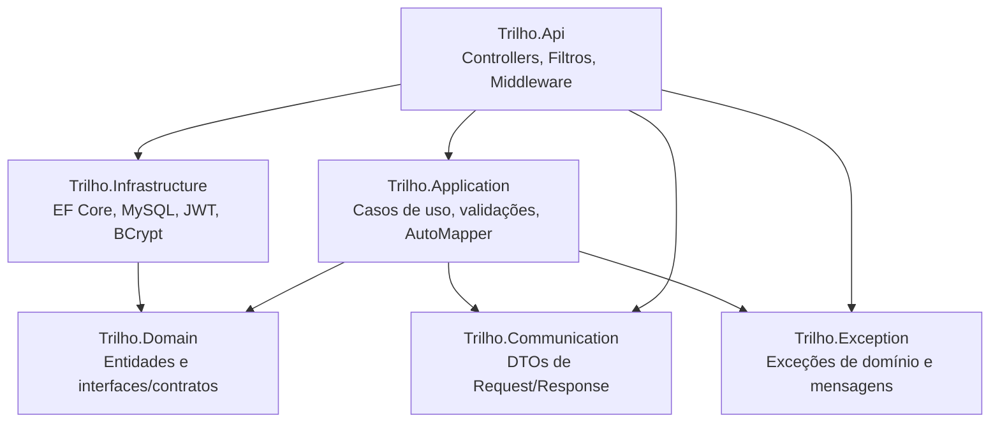

# Trilho.Api

API REST em **.NET 8** para cadastro de usuários e autenticação, construída como exemplo prático de **Clean Architecture**, princípios **SOLID** e **Injeção de Dependência**. Faz CRUD completo de usuário, hashing de senha com BCrypt e emissão de token **JWT** no login.

> Projeto de portfólio: o objetivo é demonstrar organização em camadas, separação de responsabilidades e boas práticas de uma Web API em C#, não é um produto em produção.

## Sumário

- [Sobre o projeto](#sobre-o-projeto)
- [Arquitetura](#arquitetura)
- [Tecnologias](#tecnologias)
- [Estrutura de pastas](#estrutura-de-pastas)
- [Endpoints](#endpoints)
- [Regras de validação](#regras-de-validação)
- [Segurança](#segurança)
- [Como executar](#como-executar)
- [Configuração](#configuração)
- [Possíveis evoluções](#possíveis-evoluções)

## Sobre o projeto

A API expõe operações de CRUD sobre a entidade `User` (nome, e-mail, senha e papel/role) e um endpoint de login que valida as credenciais e devolve um JWT assinado. Toda a lógica de negócio fica isolada da camada web e da camada de persistência, seguindo Clean Architecture: as regras de domínio não conhecem detalhes de infraestrutura (banco, criptografia, geração de token), apenas contratos (`interfaces`) que a Infraestrutura implementa — isso é o que viabiliza a Inversão de Dependência (o "D" do SOLID) e torna o projeto fácil de testar e de trocar peças (por exemplo, trocar MySQL por outro banco sem tocar em Domain/Application).

## Arquitetura

Solução dividida em 6 projetos, cada um com uma responsabilidade única:



- **Trilho.Domain** — núcleo da aplicação: entidade `User`, enum `Roles` e as *interfaces* (`IUserReadOnlyRepository`, `IUserWriteOnlyRepository`, `IUserUpdateOnlyRepository`, `IUnitOfWork`, `IPasswordEncripter`, `IAcessTokenGenerator`) que as demais camadas implementam. Não depende de nenhum outro projeto da solução.
- **Trilho.Application** — casos de uso (`CreateUserUseCase`, `LoginUseCase`, `UpdateUserUseCase`, `DeleteUserUseCase`, `GetAllUserUseCase`, `GetByIdUserUseCase`), validações com FluentValidation e mapeamento de objetos com AutoMapper. Orquestra o Domain, mas não sabe como os dados são persistidos.
- **Trilho.Infrastructure** — implementações concretas: `TrilhoDbContext` (EF Core + Pomelo MySQL), `UserRepository`, `UnitOfWork`, `JwtTokenGenerator` e `BCrypt` (hash de senha). É a única camada que conhece detalhes técnicos de banco/criptografia/token.
- **Trilho.Communication** — contratos de entrada e saída da API (`RequestUserJson`, `ResponseUserJson`, `ResponseErrorJson`, etc.), desacoplando o formato HTTP das entidades de domínio.
- **Trilho.Exception** — hierarquia de exceções de domínio (`TrilhoException` → `ErrorOnValidationException`, `NotFoundException`, `InvalidLoginException`) e as mensagens de erro localizáveis (`ResourceErrorsMessage`).
- **Trilho.Api** — camada de apresentação: `UserController`, filtro global de exceções (`ExceptionFilter`, que traduz cada exceção de domínio no status HTTP correspondente) e middleware de cultura (`CultureMiddleware`, seleciona idioma das mensagens de erro pelo header `Accept-Language`).

Toda dependência aponta para dentro (em direção ao Domain) — Domain não referencia nenhuma outra camada, e a Api é o único ponto de composição que conhece todos os projetos (via injeção de dependência configurada em `Program.cs`, `AddApplication()` e `AddInfrasctructure()`).

## Tecnologias

- [.NET 8](https://dotnet.microsoft.com/) / ASP.NET Core Web API
- [Entity Framework Core 8](https://learn.microsoft.com/ef/core/) + [Pomelo.EntityFrameworkCore.MySql](https://github.com/PomeloFoundation/Pomelo.EntityFrameworkCore.MySql) (MySQL)
- [FluentValidation](https://docs.fluentvalidation.net/) — validação das requisições
- [AutoMapper](https://automapper.org/) — mapeamento entre DTOs e entidades
- [BCrypt.Net-Next](https://github.com/BcryptNet/bcrypt.net) — hash de senha
- [System.IdentityModel.Tokens.Jwt](https://learn.microsoft.com/dotnet/api/system.identitymodel.tokens.jwt) — geração de token JWT
- [Swashbuckle (Swagger/OpenAPI)](https://github.com/domaindrivendev/Swashbuckle.AspNetCore) — documentação/teste interativo dos endpoints

## Estrutura de pastas

```
Trilho.sln
docker-compose.yml           # MySQL 8 para desenvolvimento
src/
├── Trilho.Api/              # Controllers, Filters, Middleware, Extensions (JWT, CORS, Swagger, rate limit), Program.cs
├── Trilho.Application/      # UseCases/, AutoMapper/, DI da camada de aplicação
├── Trilho.Communication/    # Requests/, Responses/ (DTOs)
├── Trilho.Domain/           # Entities/, Enum/, Repositories/ (interfaces), Security/, Services/ (interfaces)
├── Trilho.Exception/        # ExceptionBase/, mensagens de erro (.resx en + pt-BR)
└── Trilho.Infrastructure/   # DataAcess/ (EF Core, Configurations, repositórios), Migrations/, Security/, Seed/
tests/
├── CommonTestUtilities/     # builders compartilhados
├── UseCases.Test/           # testes unitários dos casos de uso (repositórios mockados)
└── WebApi.Test/             # testes de integração (WebApplicationFactory + banco em memória)
```

## Endpoints

Todas as rotas exigem `Authorization: Bearer <token>`, exceto as marcadas como anônimas.

| Método | Rota              | Acesso                 | Descrição                        | Sucesso   | Possíveis erros                       |
|--------|-------------------|------------------------|----------------------------------|-----------|---------------------------------------|
| POST   | `/api/Auth`      | anônimo (rate limit)   | Autentica e retorna um token JWT | 200       | 401 (credenciais inválidas), 429      |
| GET    | `/api/Auth/me`   | autenticado            | Usuário logado                   | 200       | 401                                   |
| POST   | `/api/User`      | administrador          | Cria um usuário                  | 201       | 400 (validação/e-mail duplicado), 403 |
| GET    | `/api/User`      | líder ou administrador | Lista os usuários                | 200 / 204 | 403                                   |
| GET    | `/api/User/{id}` | autenticado            | Busca um usuário por id          | 200       | 404                                   |
| PUT    | `/api/User/{id}` | próprio ou admin       | Atualiza (perfil só pelo admin)  | 204       | 400 / 403 / 404                       |
| DELETE | `/api/User/{id}` | administrador          | Remove um usuário                | 204       | 403 / 404 / 409 (a si mesmo)          |
| PUT    | `/api/User/change-password` | autenticado | Troca a própria senha (exige a atual) | 204 | 400 (senha atual incorreta/fraca) |
| PUT    | `/api/User/{id}/status` | administrador | Ativa/desativa (`{"isActive": bool}`); desativado não entra | 204 | 404 / 409 (a si mesmo ou líder de time) |
| POST   | `/api/Team`                  | administrador          | Cria um time (líder vira membro)        | 201       | 400 / 404 / 409 (líder já lidera outro) |
| GET    | `/api/Team`                  | autenticado            | Lista times (admin: todos; demais: os próprios) | 200 / 204 | —                       |
| GET    | `/api/Team/{id}`             | admin ou membro        | Detalhe com líder e membros             | 200       | 403 / 404                             |
| PUT    | `/api/Team/{id}`             | admin ou líder do time | Edita nome e descrição                  | 204       | 400 / 403 / 404 / 409 (arquivado)     |
| PUT    | `/api/Team/{id}/leader`      | administrador          | Troca o líder (antigo segue como membro) | 204      | 400 / 404 / 409                       |
| POST   | `/api/Team/{id}/member`      | admin ou líder do time | Adiciona membro                         | 204       | 400 / 403 / 404 / 409 (já é membro)   |
| DELETE | `/api/Team/{id}/member/{userId}` | admin ou líder do time | Remove membro (nunca o líder)       | 204       | 403 / 404 / 409                       |
| POST   | `/api/Team/{id}/archive` / `restore` | administrador | Arquiva / restaura o time              | 204       | 404 / 409                             |
| DELETE | `/api/Team/{id}`             | administrador          | Exclui o time                           | 204       | 404                                   |
| POST   | `/api/Task`                  | membro do time         | Cria tarefa (padrão: backlog)           | 201       | 400 / 403 / 404 / 409 (time arquivado) |
| GET    | `/api/Task`                  | autenticado            | Quadro Kanban (filtros teamId, assigneeId, status, priority) | 200 / 204 | 400 / 403 |
| GET    | `/api/Task/{id}`             | membro do time         | Detalhe: subtarefas, comentários, progresso | 200   | 403 / 404                             |
| PUT    | `/api/Task/{id}`             | membro do time         | Edita campos (registra no histórico)    | 204       | 400 / 403 / 404 / 409                 |
| PUT    | `/api/Task/{id}/move`        | membro do time         | Move de coluna/posição; `done` exige subtarefas concluídas | 204 | 400 / 403 / 404 / 409 |
| DELETE | `/api/Task/{id}`             | admin ou líder do time | Exclui (sem subtarefas pendentes)       | 204       | 403 / 404 / 409                       |
| GET    | `/api/Task/{id}/activity`    | membro do time         | Histórico de alterações                 | 200       | 403 / 404                             |
| POST/PUT/DELETE | `/api/Task/{id}/subtask[/{subtaskId}]` | membro do time | Subtarefas                  | 201 / 204 | 400 / 403 / 404 / 409                 |
| POST/DELETE | `/api/Task/{id}/comment[/{commentId}]` | membro; remover: autor, líder ou admin | Comentários | 201 / 204 | 400 / 403 / 404                |
| POST   | `/api/Invite`                | admin ou líder do time | Cria/reenvia convite por e-mail (líder: só perfil user) | 201 | 400 / 403 / 404 / 409 |
| GET    | `/api/Invite`                | admin ou líder         | Convites pendentes (líder: dos seus times) | 200 / 204 | 403                              |
| DELETE | `/api/Invite/{id}`           | admin ou líder do time | Cancela o convite                       | 204       | 403 / 404                             |
| POST   | `/api/Invite/lookup`         | anônimo (rate limit)   | Dados do convite a partir do token      | 200       | 404                                   |
| POST   | `/api/Invite/accept`         | anônimo (rate limit)   | Ativa a conta (nome + senha) e entra no time | 201  | 400 / 404 / 409                       |
| POST   | `/api/PasswordReset/request` | anônimo (rate limit)   | Envia código de 6 dígitos (resposta igual p/ e-mail inexistente) | 204 | 400                  |
| POST   | `/api/PasswordReset/verify`  | anônimo (rate limit)   | Confere o código (sem consumir)         | 204       | 400                                   |
| POST   | `/api/PasswordReset/confirm` | anônimo (rate limit)   | Define a nova senha e consome o código  | 204       | 400                                   |
| GET    | `/api/Dashboard`             | admin ou líder         | Consolidado: tarefas, carga por time (alerta > 85%), conclusões por sprint | 200 | 403              |
| GET    | `/api/Notification`          | autenticado            | Notificações do usuário + contagem de não lidas | 200 | —                                |
| PUT    | `/api/Notification/{id}/read` / `read-all` | autenticado | Marca como lida                  | 204       | 404                                   |
| GET    | `/api/Prioritization/ranking` | membro do time (ou admin) | Ranking com prioridade sugerida + justificativa (RF07) | 200 | 403          |
| POST   | `/api/Prioritization/suggest` | membro do time         | Prioridade pelo prazo + responsável com menos tarefas em aberto | 200 | 400 / 403 / 404 |
| POST   | `/api/Prioritization/apply`   | admin ou líder do time | Aplica as prioridades sugeridas (urgente declarada não é rebaixada) | 200 | 400 / 403 / 404 / 409 |
| POST   | `/api/GitRepository`         | admin ou líder do time | Conecta repositório; devolve o segredo do webhook (uma vez) | 201 | 400 / 403 / 404 / 409 |
| GET    | `/api/GitRepository`         | autenticado            | Repositórios dos seus times, status, última sync e eventos pendentes | 200 / 204 | —       |
| PUT    | `/api/GitRepository/{id}`    | admin ou líder do time | Altera eventos escutados (commit, pull_request, merge) | 204 | 400 / 403 / 404       |
| POST   | `/api/GitRepository/{id}/retry` | admin ou líder do time | Reprocessa a fila de eventos do repositório | 200 | 403 / 404                |
| DELETE | `/api/GitRepository/{id}`    | admin ou líder do time | Desconecta o repositório                | 204       | 403 / 404                             |
| POST   | `/api/GitWebhook/{repositoryId}` | anônimo + HMAC/token | Recebe eventos do GitHub/GitLab (push, PR/MR) | 202 / 204 | 401 / 404                  |
| GET    | `/health`        | anônimo                | Health check                     | 200       | —                                     |

Perfis (`role`): `administrador`, `lider`, `user`.

Todas as respostas de erro seguem o formato:
```json
{
  "errorMessages": ["mensagem do erro"]
}
```

Veja exemplos executáveis em `src/Trilho.Api/Trilho.Api.http`.

## Regras de validação

Aplicadas via FluentValidation (`CreateUserValidator` / `UpdateUserValidator`):

- **Nome** e **Role**: obrigatórios; a role deve ser `administrador`, `lider` ou `user`.
- **E-mail**: obrigatório e precisa ser um e-mail válido; não pode já estar cadastrado (checado contra o banco na criação).
- **Senha** (`PasswordValidator`): mínimo de 8 caracteres, com pelo menos 1 letra maiúscula, 1 minúscula, 1 número e 1 caractere especial (`! ? * . & $ # @`).

As mensagens de validação vêm de um arquivo de recursos (`ResourceErrorsMessage.resx`) e são resolvidas conforme o header `Accept-Language` da requisição (via `CultureMiddleware`).

## Operação e endurecimento

- **Paginação:** `GET /api/User` (padrão 100, máx. 200) e `GET /api/Task` (padrão 500, máx. 1000) aceitam `?page=&pageSize=`. A resposta continua sendo um array; o total vem em `X-Total-Count` (e `X-Page`, `X-Page-Size`), expostos no CORS.
- **Observabilidade:** todo request recebe `X-Correlation-Id` (aceita o do cliente se válido) que entra no escopo de log; erros inesperados são registrados com stack trace e devolvem mensagem genérica. Fora do desenvolvimento os logs saem em **JSON** no console.
- **Health:** `/health` (liveness) e `/health/ready` (readiness, checa o MySQL).
- **Cabeçalhos de segurança:** `nosniff`, `X-Frame-Options: DENY`, `Referrer-Policy`, CSP restritiva e `Cache-Control: no-store`; HSTS fora do desenvolvimento; corpo limitado a 1 MB.
- **JWT:** validado também por emissor/audiência (`Settings:Jwt:Issuer/Audience`).
- **Rate limit:** 10/min por IP em login/convite/redefinição e 600/min nos webhooks. Atrás de proxy reverso, ative `Settings:UseForwardedHeaders=true` para enxergar o IP real.
- **Retenção:** job diário remove eventos Git processados (30 dias) e convites/pedidos de redefinição encerrados (7 dias).
- **Dependências:** `dotnet list package --vulnerable --include-transitive` limpo; o CI falha se aparecer vulnerabilidade.

### Docker e CI

```bash
cp .env.example .env            # ajuste os segredos
docker compose --profile full up -d --build   # MySQL + API em http://localhost:8080
```

A imagem (`Dockerfile`) roda sem privilégios na porta 8080; monte um volume em `/keys` (já feito no compose) para os segredos de webhook sobreviverem a reinícios. O workflow `.github/workflows/backend-ci.yml` faz restore, build, testes, checagem de vulnerabilidades e build da imagem.

## Integração Git (RF06)

1. Admin/líder conecta o repositório (`POST /api/GitRepository`) e recebe a **URL** e o **segredo** do webhook (o segredo é mostrado uma única vez e guardado cifrado).
2. No GitHub: *Settings → Webhooks* com a URL, `application/json`, o segredo e os eventos *Pushes* e *Pull requests*. No GitLab: *Webhooks* com a URL, *Secret token* e *Push events* + *Merge request events*.
3. As tarefas são ligadas por **referência** na branch, no título/descrição do PR/MR ou no commit: `#128`, `task-128` ou `trilho-128` (só afeta tarefas do time do repositório).
4. Efeito: **PR aberto → Em Revisão**; **merge → Concluído** (com subtarefas pendentes permanece em revisão, RF04); commits atualizam branch e último commit. Tudo entra no histórico da tarefa.
5. Cada evento é gravado antes de ser processado; se falhar, fica na fila e é reprocessado a cada `Settings:Git:RetryIntervalSeconds` (até `MaxAttempts`) ou em *Sincronizar agora*. O repositório fica com status `error` enquanto houver falha.
6. Segurança: assinatura `X-Hub-Signature-256` (HMAC-SHA256, GitHub) ou `X-Gitlab-Token` (GitLab), conferida em tempo constante **antes** de gravar qualquer coisa. Em produção, persista as chaves de Data Protection (`Settings:DataProtectionKeysPath`).

## Segurança

- **Senhas** nunca são armazenadas em texto puro: são hasheadas com **BCrypt** antes de persistir.
- **JWT** (HMAC-SHA256) com claims `unique_name`, `sid` (Guid), `id` (id numérico, usado nas rotas) e `role`. A API valida assinatura e expiração; sem `Settings:Jwt:SigningKey` (mín. 32 caracteres) a aplicação **não sobe**.
- **Autorização** por políticas (`AdminOnly`, `LeaderOrAdmin`) e regras de negócio nos casos de uso via `ILoggedUser` (membro edita só o próprio perfil; só admin altera perfil de acesso).
- **Não há autocadastro**: o primeiro administrador é criado por seed (`Settings:SeedAdmin`).
- **Rate limit** de 10 requisições/min por IP no login; **CORS** restrito a `Settings:AllowedOrigins`.
- **Segredos** (chave JWT, senha do banco, senha do admin) ficam fora do repositório: user-secrets ou variáveis de ambiente.

## Como executar

### Pré-requisitos
- [.NET 8 SDK](https://dotnet.microsoft.com/download/dotnet/8.0)
- Docker (para o MySQL do `docker-compose.yml`) ou um MySQL 8 acessível

### Passos
1. Suba o banco e restaure as dependências:
   ```bash
   docker compose up -d
   dotnet restore Trilho.sln
   ```
2. Configure os segredos (nunca em `appsettings.json`):
   ```bash
   cd src/Trilho.Api
   dotnet user-secrets set "Settings:Jwt:SigningKey" "<chave-aleatoria-com-32+-caracteres>"
   dotnet user-secrets set "Settings:SeedAdmin:Email" "admin@trilho.local"
   dotnet user-secrets set "Settings:SeedAdmin:Password" "<senha-do-admin>"
   ```
   Em desenvolvimento a connection string e o CORS (`http://localhost:3000`) vêm de `appsettings.Development.json`. Em produção use variáveis de ambiente (`Settings__Jwt__SigningKey`, `ConnectionStrings__Connection`, ...).
3. Rode a aplicação:
   ```bash
   dotnet run --project src/Trilho.Api
   ```
   As *migrations* são aplicadas e o admin inicial é criado na inicialização.
4. Acesse o Swagger em `http://localhost:5018/swagger` (use **Authorize** com o token do login).

### Testes
```bash
dotnet test Trilho.sln
```

### Nova migration
```bash
dotnet tool restore
dotnet tool run dotnet-ef migrations add <Nome> --project src/Trilho.Infrastructure --startup-project src/Trilho.Api --output-dir Migrations
```
Defina `Settings__Jwt__SigningKey` no ambiente: a API valida a chave ao montar o host, inclusive em tempo de design do EF.

## Configuração

| Chave                                           | Descrição                                                 |
|-------------------------------------------------|-----------------------------------------------------------|
| `ConnectionStrings:Connection`                 | Connection string do MySQL                                |
| `Settings:Jwt:SigningKey`                      | Chave de assinatura do JWT (obrigatória, ≥ 32 caracteres) |
| `Settings:Jwt:ExpiresMinutes`                  | Validade do token, em minutos (padrão 480 = 8 h). Não há refresh token: ao expirar o front limpa a sessão e volta ao login. Desativar a conta invalida o token na hora |
| `Settings:FrontendBaseUrl`                    | Base dos links enviados por e-mail (ex: ativação de conta)  |
| `Settings:Invite:ExpiresDays`                 | Validade do convite, em dias (padrão 7)                   |
| `Settings:PasswordReset:{ExpiresMinutes,MaxAttempts}` | Validade (15 min) e tentativas (5) do código       |
| `Settings:RateLimiting:{AuthPermitLimit,WebhookPermitLimit}` | Requisições por minuto e por IP nas rotas de autenticação (10) e nos webhooks (600). Atrás de um front hospedado (Vercel) suba o primeiro (ex.: 120) |
| `Settings:Login:{MaxFailedAttempts,LockoutMinutes}` | Senhas erradas seguidas que bloqueiam a conta (5) e por quantos minutos (15); a resposta é 429. Redefinir a senha destrava |
| `Settings:SeedDemo:{Enabled,Password}` | Cria dados de demonstração (time, 3 usuários `@trilho.demo`, 8 tarefas) uma única vez; a senha vem de user-secrets/variável de ambiente. Deixe desligado em produção |
| `Settings:Email:Provider`                    | `Log` (padrão: só registra no log) ou `Smtp` (envio real)  |
| `Settings:Email:Smtp:{Host,Port,UserName,Password,EnableSsl,FromAddress,FromName}` | Servidor SMTP; senha via user-secrets/variável de ambiente |
| `Settings:Email:LogBody`                      | Em dev, registra o corpo do e-mail (link/código) no log   |
| `Settings:PublicApiBaseUrl`                   | Base pública da API usada na URL do webhook exibida ao conectar |
| `Settings:Git:{MaxAttempts,RetryIntervalSeconds}` | Tentativas por evento (5) e intervalo do reprocessamento (60 s) |
| `Settings:DataProtectionKeysPath`              | Pasta persistente das chaves que cifram os segredos de webhook |
| `Settings:AllowedOrigins`                      | Origens permitidas no CORS (lista)                        |
| `Settings:SeedAdmin:{Name,Email,Password}`     | Administrador inicial (criado se o e-mail não existir)    |
| `Settings:SprintLengthDays`                    | Janela (dias) dos sprints derivados por data              |
| `Settings:SprintAnchorDate`                    | Primeiro dia do sprint S1 (as janelas seguem a partir dela) |
| `Settings:Notifications:{DueSoonHours,DueSoonCheckMinutes}` | Antecedência (48h) e frequência (60 min) do aviso de prazo |
| `Settings:Workload:TasksPerMember`             | Capacidade por membro usada na carga de trabalho          |
| `Settings:Workload:AlertThresholdPercent`      | Limite (%) para alerta de sobrecarga                      |

## Possíveis evoluções

- Provedores de e-mail por API (SendGrid/Resend) como novas implementações de `IEmailSender`.
- Trocar o motor de priorização por regras (`RuleBasedPrioritizationEngine`) por um modelo de ML via `IPrioritizationEngine`.
- Paginação das demais listagens (times, convites, repositórios) e bloqueio por tentativas de login (além do rate limit por IP).
- Métricas/tracing (OpenTelemetry) e envio dos logs a um agregador.

---

Projeto pessoal desenvolvido para fins de estudo/portfólio.
